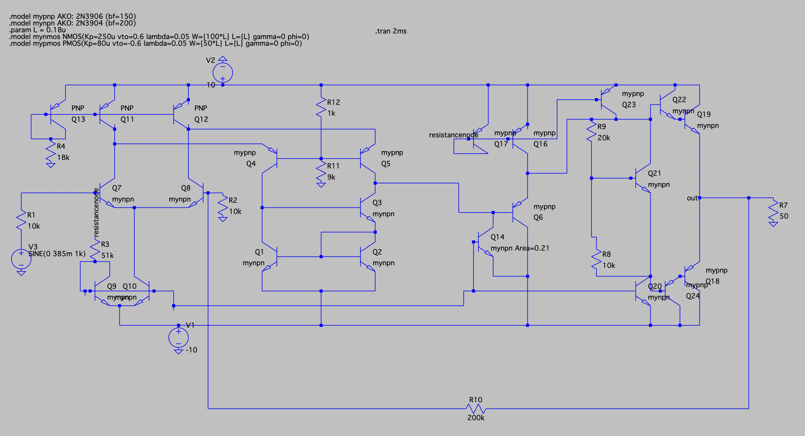

# Multi-Stage Audio Power Amplifier

A discrete BJT-based **Multi-Stage Class AB Audio Power Amplifier** with global negative feedback, designed and simulated in **LTspice** to drive a heavy $50\,\Omega$ load with high linearity, wide dynamic range, and ultra-low Total Harmonic Distortion ($\text{THD} < 0.08\%$).

> **Course:** Electronics II — Final Design Project (Phase 2)  
> **Institution:** Sharif University of Technology  
> **Author:** Mahshad Ghoddousi Boroujeni

---

## Circuit Schematic



---

## Key Features & Architecture

The amplifier is designed entirely with discrete bipolar junction transistors (23 BJTs and 9 resistors, with zero capacitors—fully DC-coupled) and consists of the following integrated stages:

1. **Differential Input Stage:**
   * Built around an NPN differential pair ($Q_7, Q_8$) biased by a shared current mirror tail ($Q_9, Q_{10}$) and active PNP current mirror loads ($Q_{11}, Q_{12}, Q_{13}$).
   * Provides high Common-Mode Rejection Ratio (CMRR) and serves as the summing junction for the global feedback loop.

2. **Intermediate Voltage Amplification Stages (VAS):**
   * Secondary differential/cascode-like gain stage ($Q_1$–$Q_5$) followed by a high-gain driver stage ($Q_6, Q_{14}$).
   * Uses emitter-area scaling on $Q_{14}$ ($\text{Area} = 0.21$) and shared bias reference resistors to optimize component count and power consumption.

3. **Class AB Push-Pull Power Output Stage:**
   * Complementary symmetry output network ($Q_{18}, Q_{19}$ with drivers/buffers $Q_{20}, Q_{22}, Q_{23}, Q_{24}$) capable of sourcing and sinking over $172\,\text{mA}$ into a $50\,\Omega$ load.
   * Biased in Class AB using a **$V_{BE}$ Multiplier** ($Q_{21}$, $R_8 = 20\,\text{k}\Omega$, $R_9 = 10\,\text{k}\Omega$) that establishes a stable quiescent current ($\approx 6.13\,\text{mA}$), completely eliminating crossover distortion.

4. **Global Voltage-Series Negative Feedback:**
   * Samples the output voltage directly at node `out` and returns a fraction of it via $R_f = 200\,\text{k}\Omega$ ($R_{10}$) and $R_g = 10\,\text{k}\Omega$ ($R_2$) to the inverting input (base of $Q_8$).
   * Stabilizes the closed-loop voltage gain at $A_v \approx 1 + \frac{R_f}{R_g} = 21\,\text{V/V}$, drastically boosts differential input impedance, lowers output impedance, and suppresses nonlinear harmonic distortion.

---

## Performance Specifications & Simulation Results

The circuit operates from dual $\pm 10\,\text{V}$ DC power supplies and meets all target design specifications:

| Parameter | Symbol | Target Requirement | Achieved Value | Status |
| :--- | :---: | :---: | :---: | :---: |
| **Output Load Resistance** | $R_L$ | $50\,\Omega$ | $50\,\Omega$ | Pass |
| **Closed-Loop Gain (at $1\,\text{kHz}$)** | $\|A_{v,\text{closed}}\|$ | $18 \le \|A_v\| \le 22$ | $20.89\,\text{V/V}\ (26.40\,\text{dB})$ | Pass |
| **Feedback Resistors** | $R_f,\ R_g$ | $10\,\text{k}\Omega \le R \le 200\,\text{k}\Omega$ | $200\,\text{k}\Omega,\ 10\,\text{k}\Omega$ | Pass |
| **Max Unclipped Output Swing** | $V_{\text{out,pp}}$ | $\ge 16\,\text{V}_{\text{pp}}$ | $16.33\,\text{V}_{\text{pp}}$ | Pass |
| **Output Stage Efficiency (at $16\,\text{V}_{\text{pp}}$)** | $\eta_{\text{out}}$ | $> 60\%$ | $70.88\%$ | Pass |
| **Total Power Consumption ($V_{\text{in}} = 50\,\text{mV}$)** | $P_{\text{total}}$ | $\le 190\,\text{mW}$ | $154.82\,\text{mW}$ | Pass |
| **THD (Normal Operation)** | $\text{THD}_{\text{normal}}$ | $< 0.08\%$ | $0.0619\%$ | Pass |
| **THD (With Noisy Bias Sources)** | $\text{THD}_{\text{noisy}}$ | $< 1\%$ | $0.0782\%$ | Pass |
| **Power Supply Rejection Ratio ($10\,\text{mV}$ ripple)** | $\text{PSRR}$ | Reported | $40.72\,\text{dB}\ (\Delta V_{\text{out}} = 92\,\mu\text{V})$ | Pass |
| **Differential Input Resistance** | $R_{\text{in,diff}}$ | $> 1\,\text{M}\Omega$ | $14.26\,\text{M}\Omega$ | Pass |
| **Output Resistance (without $R_L$)** | $R_{\text{out}}$ | $< 50\,\Omega$ | $3.35\,\Omega$ | Pass |
| **Total Circuit Cost** | $\text{Cost}$ | $\le 200$ | $205$ (23 BJTs, 9 Resistors) | Minor Penalty ($2\%$) |

---

## Theoretical Summary

* **Closed-Loop Gain:**
  $$A_{v,\text{closed}} \approx 1 + \frac{R_f}{R_g} = 1 + \frac{200\,\text{k}\Omega}{10\,\text{k}\Omega} = 21\,\text{V/V}$$

* **Output Stage Swing & Efficiency:**
  $$V_{p,\max} \approx V_{CC} - V_{CE,\text{sat}} - 2V_{BE} \approx 10 - 0.2 - 1.2 = 8.6\,\text{V}$$
  $$\eta = \frac{P_{\text{out}}}{P_{\text{supply}}} = \frac{\pi}{4} \cdot \frac{V_p}{V_{CC}}$$

* **Closed-Loop Impedances (with Open-Loop Gain $A_{\text{OL}} \approx 7400\,\text{V/V}$ and $\beta_{\text{FB}} = \frac{1}{21}$):**
  $$R_{\text{in,CL}} = R_{\text{id,OL}} \times (1 + A_{\text{OL}}\beta_{\text{FB}}) \approx 40.4\,\text{k}\Omega \times 353 \approx 14.26\,\text{M}\Omega$$
  $$R_{\text{out,CL}} = \frac{R_{\text{out,OL}}}{1 + A_{\text{OL}}\beta_{\text{FB}}} \approx \frac{1182\,\Omega}{353} \approx 3.35\,\Omega$$

---

## Repository Structure

```text
├── multi-stage-audio-amplifier.asc   # Main LTspice schematic file
├── amplifier-schematic.png           # Exported schematic image
├── audio.wav                         # Normalized mono input audio test signal
├── output.wav                        # Amplified output audio waveform from LTspice
├── report/                           # Complete project report (LaTeX source & PDF)
└── README.md                         # Project documentation
```

---

## How to Run the Simulations

### 1. Prerequisites
* **LTspice XVII** (or newer)
* **Python 3.x** (optional, for audio `.wav` preprocessing and normalization)

### 2. Running Transient, Power, and THD Analyses
1. Open `multi-stage-audio-amplifier.asc` in LTspice.
2. Ensure the active SPICE directives on the schematic include:
   ```spice
   .tran 10m
   .meas TRAN P_R_l RMS V(out)*I(R7)
   .meas TRAN P RMS 10*I(V2)+10*I(V1)
   .FOUR 1khz 100 V(out)
   ```
3. Click **Run** and probe node `V(out)` to view the amplified waveform.
4. Press `Ctrl + L` (View $\rightarrow$ SPICE Error Log) to inspect the RMS load power (`p_r_l`), total supply power (`p`), and Fourier harmonic distortion (`THD`).

### 3. Running Small-Signal AC Impedance Tests ($R_{\text{in,diff}}$ and $R_{\text{out}}$)
* **Input Resistance ($R_{\text{in,diff}}$):** Set input source $V_3$ to `AC 1`, run `.ac list 1k`, and plot `V(N010)/Ib(Q7)`.
* **Output Resistance ($R_{\text{out}}$):** Set input source $V_3$ to `0`, disconnect load resistor $R_7$, attach a $1\,\text{V}$ AC test source $V_4$ to node `out`, run `.ac list 1k`, and plot `V(out)/I(V4)`.

### 4. Real Audio Signal Amplification
* Replace the sine wave definition on $V_3$ with `wavefile="audio.wav"` and include the directive `.wave output.wav 16 44.1k V(out)` to generate the amplified audio file.

---

## Tools Used

* **LTspice XVII** — Circuit design, DC operating point (`.op`), transient (`.tran`), Fourier (`.four`), and small-signal AC (`.ac`) simulations.
* **Python** — Audio `.wav` channel conversion and peak amplitude normalization.
* **LaTeX (XePersian / Overleaf)** — Technical documentation and report typesetting.